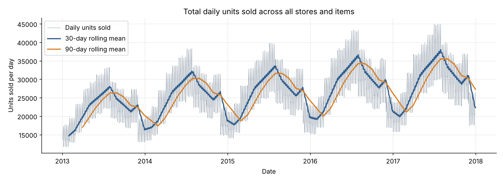
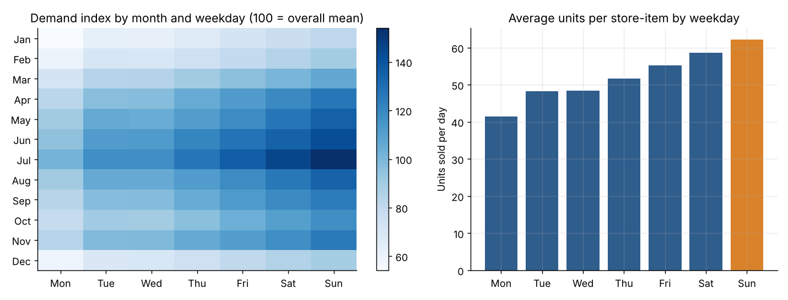
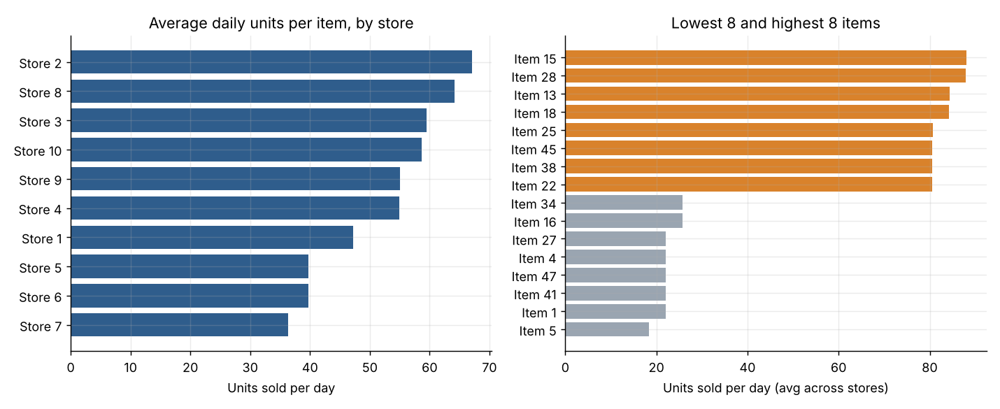
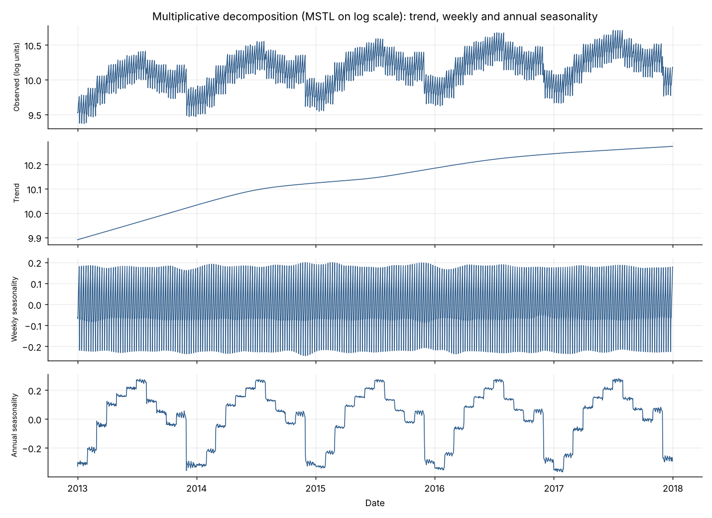
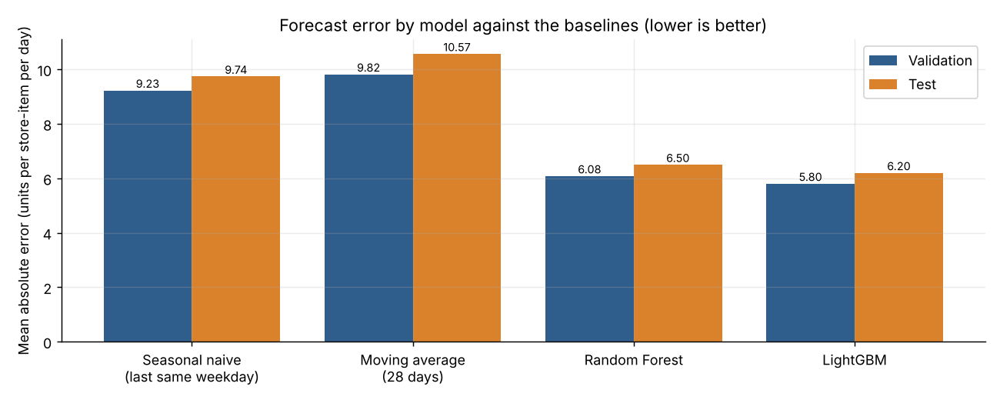
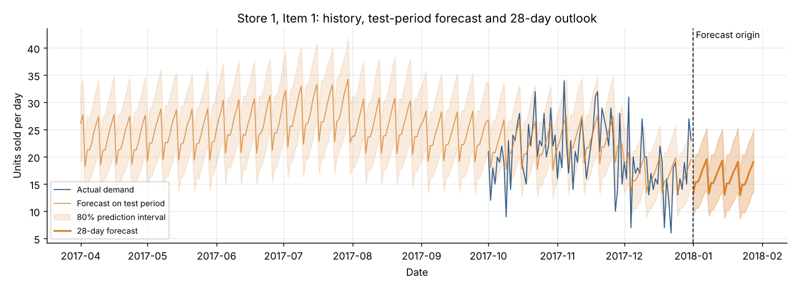

# AI-Powered Demand Forecasting & Predictive Analytics System

An end-to-end retail demand forecasting project: from a raw 5-year sales history to a 28-day forecast with prediction intervals, an interactive Streamlit dashboard and business recommendations.

> **Chain:** Retail → plan stock and staff per store and item → Kaggle Store Item Demand dataset (913,000 daily records) → LightGBM global model with calendar and lag features, 28-day direct horizon → 28-day forecast per store-item with an 80% range → reorder points, staffing and purchasing decisions.

**Headline result:** on the untouched test period (Apr to Dec 2017) LightGBM reaches an MAE of **6.20 units** per store-item per day against **9.74** for the best simple baseline (last same weekday), **36% lower error**, with an 80% prediction interval that covers **80.0%** of actual values.

## 01. Project Overview

| Item | Choice |
|---|---|
| Industry | Retail |
| Target | Units sold per store, item and day |
| Horizon | 28 days (direct strategy) |
| Granularity | Daily, 10 stores x 50 items = 500 series |
| Main model | LightGBM (point model plus two quantile models for the 80% range) |
| Main metric | MAE in units (easy to explain), with RMSE, sMAPE, WAPE and R2 alongside |

Pipeline: historical data → cleaning → EDA → decomposition → feature engineering → baselines and models → evaluation → forecast → dashboard → recommendations.

## 02. Business Problem

A retailer with 50 products across 10 stores plans on last year's spreadsheet. Over-ordering ties up cash and under-ordering loses sales. The system answers: what will demand be over the next four weeks and how sure are we, which items are growing, when is the next seasonal peak, and when should stock be reordered given a supplier lead time.

## 03. Dataset

| Property | Value |
|---|---|
| Source | Kaggle "Store Item Demand Forecasting Challenge" (`train.csv`) |
| Obtained from | Public GitHub copy, downloaded by `data/download_data.py` in November 2026 |
| Licence | **Not verified from this environment. Check the Kaggle competition rules before publishing.** The raw CSV is excluded from git by `.gitignore` and fetched by script. |
| Records / features | 913,000 rows, 4 columns (date, store, item, sales) |
| Period / granularity | 2013-01-01 to 2017-12-31, daily, 1,826 days |
| Target | `sales`, units sold per store-item-day |
| Limitations | Anonymised stores and items. No price, promotion, weather, stock or revenue fields. No stockout flags, so zero or low sales cannot be separated from lost sales. Series are very regular, so accuracy here will be higher than on messier real retail data. |

Data quality (`reports/data_quality.json`): no missing values, no duplicates, no repeated keys, no missing calendar dates, no negatives, one zero-sales record (0.0001%). A reindex to a full calendar added no rows.

## 04. Data Dictionary

| Field | Type | Description |
|---|---|---|
| `date` | datetime | Calendar day |
| `store` | int (1-10) | Store identifier |
| `item` | int (1-50) | Item identifier |
| `sales` | float | Units sold (target) |

Engineered fields are listed in section 07.

## 05. EDA

Figures are in `images/` and discussed in `notebooks/01_eda_and_decomposition.ipynb`.


*Demand grows every year (2014 +15.0%, 2015 +4.4%, 2016 +8.3%, 2017 +3.9%). The model needs a level or growth signal because trees do not extrapolate.*


*Monday is 21% below the average day and Sunday 19% above. July is the annual peak (index 128) and January the low (68). Both repeat yearly, so calendar features can encode them.*


*Store level ranges from 36 to 67 units per item per day and item level from 18 to 88. One global model with store and item as categories is justified.*

Other findings: demand is mildly right-skewed (skew 0.87, median 47, p99 135) with almost no zeros, so it is not intermittent. All 50 items grew 2.8% to 4.5% in 2017 and all stores share the same seasonal shape.

**Outliers.** 1,175 points (0.13%) were flagged with a robust z-score (>4) against the store-item-weekday-year median. Only 7.7% fall on holidays. None was shown to be a recording error, so **none was removed** (`reports/flagged_outliers.csv`).

## 06. Time-Series Analysis



- Method: MSTL on log demand with periods 7 and 365, equivalent to a multiplicative decomposition, chosen because the seasonal swing grows with the level.
- Weekly swing about 44% and annual swing about 63% of the level.
- Residual standard deviation is 0.010 in logs but autocorrelated (lag 1: 0.50, lag 7: 0.30), so recent-level features still carry information.
- Stationarity: the level series is borderline (ADF p=0.03, KPSS p=0.01). One regular or one weekly difference gives ADF p<1e-8. This supports an ML approach with explicit calendar and lag features over a hand-tuned SARIMA.

## 07. Feature Engineering

Every feature for a target day uses only data from **at least 28 days earlier**, which makes the 28-day direct forecast leakage-free by construction.

| Group | Features | Hypothesis |
|---|---|---|
| Lag | lag 28, 35, 42, 49, 56, 91, 364 | Same-weekday demand from earlier cycles and last year predicts the day |
| Rolling | mean 7/14/28/56/91 and std 28, all shifted by 28 days | Smoothed recent level and volatility |
| Same weekday | mean of lags 28 to 56 on the same weekday | Weekday-specific recent level |
| Year-ago | 7-day mean around the same day last year, 91-day trend ratio | Annual seasonality and growth |
| Calendar | weekday, day of month, month, quarter, day of year, week of year, weekend, month start/end | Weekly and annual rhythm |
| Holiday | US federal holiday flag and signed distance (-7 to +7 days) | Holiday surges (US calendar is an assumption, the data does not say where the stores are) |
| Entity | store, item (categorical) | Shared structure across series |

Rows with undefined short lags (the first 119 days) are dropped. Year-ago features are left empty for the first year and handled natively by LightGBM.

**Leakage controls:** `tests/test_leakage.py` perturbs all data after `date - 28 days` and asserts features for that date are unchanged, recomputes three features by hand for one row, and checks splits are chronological. Run `pytest tests`.

## 08. Forecasting Models

| Role | Model | Why |
|---|---|---|
| Baseline | Seasonal naive (last same weekday before the forecast origin) | Strongest simple rule |
| Baseline | Moving average (28 days) | Simple level benchmark |
| Baseline | Seasonal naive, same weekday 28 days earlier | Uses the same information gap as the ML features |
| Statistical | Exponential smoothing (Holt-Winters, additive damped trend, weekly season) | Standard statistical benchmark, fit per series on a 730-day window |
| ML | Random Forest | Robust, little tuning |
| ML (selected) | LightGBM | Fast on a 500-series panel, native categorical and missing-value handling |

Not used: **SARIMA/ARIMA** (500 series x slow seasonal parameter search, and a single weekly period cannot express the annual cycle), **Prophet** (not installed in this environment and one model per series), **LSTM/GRU/TFT** (a calendar-driven problem with 5 years of history does not justify the cost). Holt-Winters was evaluated on a random sample of 60 series (1,200 fits) to keep runtime reasonable, so it is compared like for like on that sample.

## 09. Model Evaluation

Chronological split: train 2013-01-01 to 2016-06-30 (effective training rows start 2013-04-30), validation 2016-07-01 to 2017-03-31, test 2017-04-01 to 2017-12-31 (about 70/15/15). Hyperparameters were tuned on validation only. Final models were refit on train+validation before scoring the test period.

**Test period, all 500 series:**

| Model | MAE | RMSE | sMAPE % | WAPE % | R2 |
|---|---|---|---|---|---|
| Seasonal naive, last same weekday (baseline) | 9.74 | 12.79 | 17.5 | 15.4 | 0.846 |
| Moving average, 28 days | 10.57 | 13.90 | 18.0 | 16.8 | 0.818 |
| Seasonal naive, 28 days earlier | 10.77 | 14.17 | 19.0 | 17.1 | 0.811 |
| Random Forest | 6.50 | 8.44 | 11.8 | 10.3 | 0.933 |
| **LightGBM** | **6.20** | **8.03** | **11.4** | **9.8** | **0.939** |

**Like for like on the 60-series sample (test):** baseline 9.87, Holt-Winters 8.05, Random Forest 6.57, LightGBM 6.32 (see `reports/ets_comparison.json`).



Selection: LightGBM is best on every metric, trains in about 33 seconds on one CPU core and is stable between validation (5.80) and test (6.20). Random Forest is only 5% worse, so it is a fine fallback if LightGBM is not available.

**Training record** (`reports/metrics.json`): Python 3.12, LightGBM 4.7.0, scikit-learn 1.9.1, statsmodels 0.15.0, seed 42, 1 CPU core. Full pipeline about 10 minutes plus about 3.5 minutes for Holt-Winters.

| Model | Final hyperparameters |
|---|---|
| LightGBM | objective L1 on ratio target (demand divided by 91-day level), `num_leaves` 63, `learning_rate` 0.06, `max_depth` -1, `min_child_samples` 100, `feature_fraction` 0.8, `bagging_fraction` 0.8, rounds 101 (validation), 116 (train+val), 121 (all history) |
| Random Forest | 60 trees, `max_depth` 14, `min_samples_leaf` 30, `max_features` 0.5, `max_samples` 0.25 |
| Holt-Winters | additive trend damped, additive season, period 7, 730-day window |

Tuning grid (validation MAE): raw L2 5.91, raw L1 5.91, ratio L1 63 leaves **5.80**, ratio L1 127 leaves 5.81.

## 10. Forecast Results



- Strategy: **direct**, a single model forecasts any day 28 days ahead; no recursive lag feeding.
- Next 28 days (2018-01-01 to 2018-01-28), all stores and items: **605,363 units**, 80% range per store-item summed to 494,000 to 723,000 (a conservative range, since summing item bounds assumes they all miss together).
- The 80% interval comes from LightGBM quantile models at 10% and 90%. It covered 79.9% on validation and 80.0% on test, and stayed between 79% and 81% in every test month.
- At chain level the daily forecast error is 0.85% of volume (`reports/error_findings.json`).

**Caution:** the forecast is +8.2% against the same weeks of January 2017, while 2017 as a whole grew 3.9%. In validation the model over-forecast January to March 2017 by about 2%, so the growth figure is probably somewhat high. Check it against actuals as January data arrives.

## 11. Dashboard

```bash
streamlit run dashboard/app.py
```

Panels: **Overview** (total sales, average demand, forecast, growth indicator), **Demand trends** (history, forecast and weekday/month patterns), **Product analysis** (item ranking and item-level forecast with range), **Forecast performance** (all models against the baseline, interval coverage), **Business insights** (growth, uncertainty, seasonal weeks and a reorder planner). Use the sidebar to filter by store and item. Blue is actual demand, orange is forecast, grey is the baseline throughout.

Add screenshots of the five panels to `images/` before publishing (for example `images/dashboard_overview.png`).

## 12. Business Insights

Full detail in `reports/business_insights.md`.

- **Staffing:** Sunday demand is 19% above an average day, Saturday 12%, Monday 21% below. The three busiest forecast days are Sundays (7, 21 and 28 January).
- **Purchasing:** demand peaks in weeks 26 to 30 (index 123 to 129, up to 29% above average) and troughs in weeks 1 to 4 (about 68). Order ahead of the summer peak and cut January orders.
- **Inventory:** safety stock for a 7-day lead time at 95% service is about 9% of lead-time demand overall; items 5, 41, 27, 47 and 1 have the widest ranges (61% to 66% of forecast) and need the most.
- **Growth and decline:** no item is forecast to decline. Fastest growth: items 2 (+12.0%), 40, 38, 18, 30. Slowest: items 5, 34, 41, 49, 1 (+4% to +6%).
- **Marketing:** promote in the January to February trough, avoid discounting in summer peak weeks.

## 13. Installation

```bash
git clone <your-repo-url>
cd <repo-folder>
python -m venv .venv && source .venv/bin/activate
pip install -r requirements.txt
```

## 14. Usage

```bash
python data/download_data.py     # fetch the raw dataset
python -m src.run_pipeline       # clean, train, evaluate, forecast, charts, insights (~14 min on 1 CPU)
streamlit run dashboard/app.py   # open the dashboard
pytest tests                     # leakage and split checks
```

Trained models are saved in `models/`. Processed data, predictions and forecasts are in `data/processed/` so the dashboard runs without retraining.

```
data/        download script, processed data (raw CSV is git-ignored)
notebooks/   EDA and decomposition, modelling and evaluation
src/         data, features, models, evaluation, analysis, insights
models/      LightGBM point and quantile models
dashboard/   Streamlit app
reports/     metrics, data quality, error analysis, business insights
images/      exported charts
tests/       leakage and split tests
```

## 15. Limitations

- Anonymised dataset with no price, promotion, weather or stock fields. Drivers of demand are limited to calendar, history and entity.
- Most of the model's gain comes from calendar features (week of year, weekday and month account for 88% of importance). The data is very regular, so results will not transfer unchanged to noisier retail data.
- With lags of at least 28 days, the model does not use the last four weeks of sales even for tomorrow. A 7-day horizon model with short lags would likely be more accurate for replenishment.
- The model over-forecast Q1 2017 by about 2% in validation.
- Holiday flags use the US federal calendar as an assumption.
- Holt-Winters was run on 60 series, not all 500. SARIMA, Prophet and deep learning were not run.
- No stock data, so the reorder planner takes stock as a user input and uses an assumed lead time.
- Zero or low sales cannot be separated from stockouts.

## 16. Future Improvements

- Add a 7-day model using lags 1 to 7 and compare error by horizon.
- Add promotion, price and weather features and validate each with the same chronological test.
- Per-item bias correction or conformal calibration of intervals.
- Walk-forward validation with several forecast origins.
- Scheduled retraining and drift monitoring; a FastAPI service for the forecasts.
